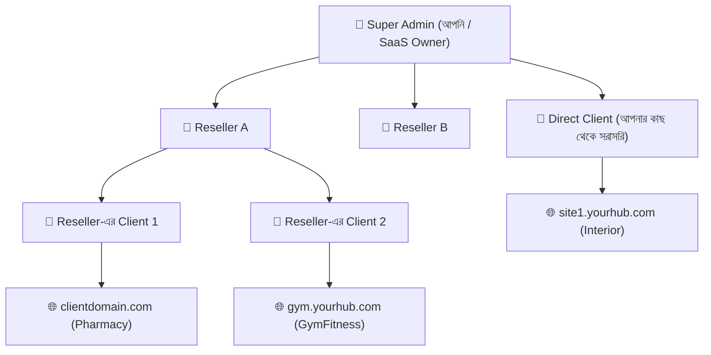
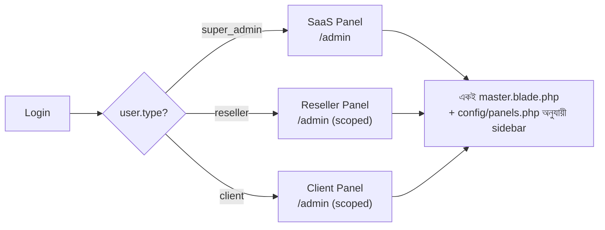
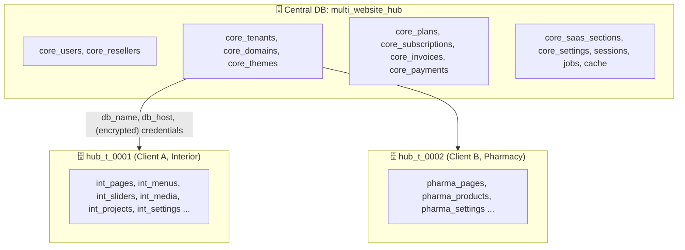
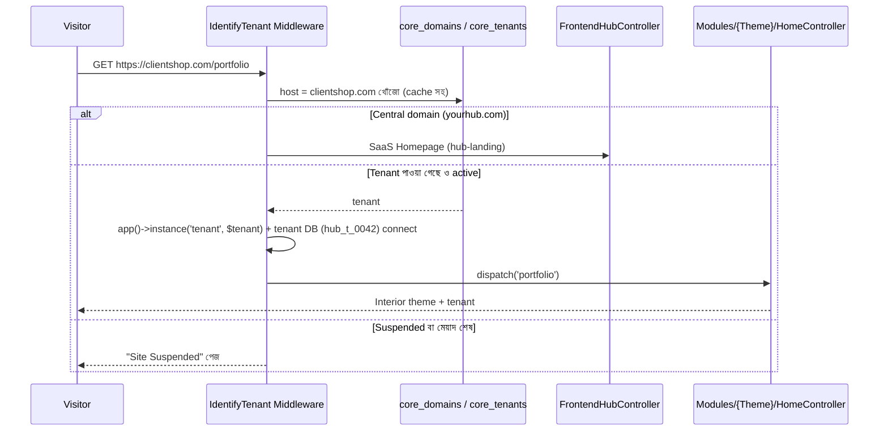
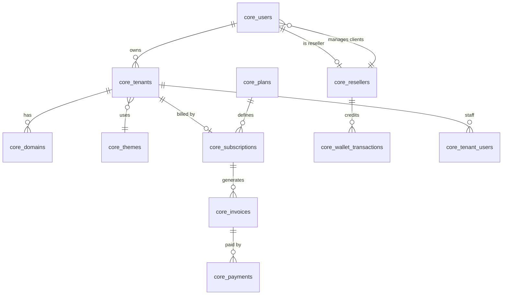
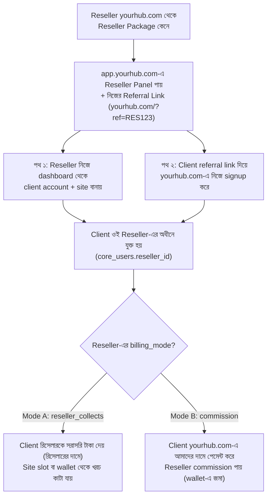
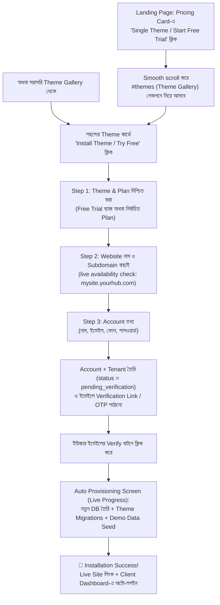
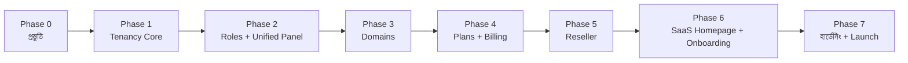

# 🚀 SaaS মাস্টার প্ল্যান: Multi-Website Hub → Multi-Tenant SaaS

> **লক্ষ্য:** এখনকার Laravel Modular Hub-কে (১১টা theme module) একটা পূর্ণ SaaS প্ল্যাটফর্মে রূপ দেওয়া। এখানে তিন ধরনের ব্যবহারকারী থাকবে: **SaaS Owner (আপনি)**, **Reseller** আর **Client**। প্রত্যেক client নিজের subdomain বা custom domain-এ একটা theme চালাবে।

---

## 1. বর্তমান অবস্থা (কোডবেস বিশ্লেষণ)

| বিষয় | এখন যা আছে | SaaS-এর জন্য যা লাগবে |
|---|---|---|
| Theme modules | ১১টা (Interior, RealEstate, Pharmacy, TechCompany, Clinic, Portfolio, IvfCenter, HajjUmrah, GymFitness, WonderLearn, EventManagement) | ✅ যেমন আছে তেমনই ব্যবহার হবে (theme হিসেবে) |
| Website registry | `core_websites` (প্রতি module-এ ১টা website) | প্রতি **client**-এর একাধিক website (tenant) |
| Module data | `int_pages`, `re_menus` ইত্যাদি, সবই একটা DB-তে | **প্রতি tenant-এর আলাদা Database**: module tables tenant DB-তে যাবে, `tenant_id` লাগবে না |
| Frontend routing | `FrontendHubController` → `/` বা `/{slug}` | **Domain/Subdomain দেখে** tenant ঠিক করা হবে |
| Admin | একটাই Global Admin (`ModuleCmsController`, `GlobalAdminController`) | একই layout, কিন্তু **role অনুযায়ী ৩টা panel** |
| Uploads | `Modules/{Module}/Public/uploads/{folder}` | `Modules/{Module}/Public/uploads/t{tenant_id}/{folder}` |
| Billing | `Transaction` model আছে | Plans, Subscriptions, Invoices, Payment Gateway |

> [!WARNING]
> **`AGENTS.md`-এর সাথে conflict:** `AGENTS.md`-এ লেখা আছে **"Single Active Module Mode"**, মানে প্রতি deployment-এ মাত্র ১টা module চলবে, `public/module-assets` symlink-ও ১টা। কিন্তু SaaS-এ **সব theme একসাথে চলবে** (একজন client Interior চালাবে, আরেকজন Pharmacy)। তাই প্রস্তাব হলো `.env`-এ `APP_MODE=saas|single` রাখা:
> - `single` → আগের মতো (`demo:activate` / `demo:handover` কাজ করবে, একক client-কে কোড হস্তান্তরের জন্য)
> - `saas` → multi-tenant mode
>
> ✅ **সিদ্ধান্ত (২০২৬-১১-২৩): অনুমোদিত।** Phase 0-এ `AGENTS.md` আপডেট করা হবে। Default হবে `APP_MODE=saas`। পুরনো Single-Active-Module নিয়ম আর `demo:activate` / `demo:handover` শুধু `single` mode-এ চলবে।

---

## 2. ব্যবহারকারীর স্তর (Role Hierarchy)



| Role | কে | যা করতে পারবে |
|---|---|---|
| **Super Admin** | আপনি | সব কিছু: plans, themes, resellers, clients, domains, billing, global settings, impersonate |
| **Reseller** | আপনার কাছ থেকে package কিনবে, **আপনার brand (yourhub)-এর বিক্রেতা বা এজেন্ট** হিসেবে কাজ করবে। নিজের কোনো site বা white-label থাকবে না | নিজের client বানাবে, referral link দিয়ে client আনবে, তাদের theme install করে দেবে, নিজের quota-র মধ্যে site বানাবে, commission বা wallet দেখবে |
| **Client (Tenant Owner)** | শেষ ব্যবহারকারী | নিজের website(গুলো) চালাবে: pages, menus, slider, media, theme settings, domain connect |
| **Client Staff** | Client-এর কর্মী | Client যতটুকু permission দেবে ততটুকু (editor, viewer) |

---

## 3. ড্যাশবোর্ড কৌশল: একই ডিজাইন, শর্ত দিয়ে ৩টা Panel

আপনি যেমন বলেছেন, **একটাই dashboard layout** (`resources/views/admin/layouts/master.blade.php`) থাকবে। লগইন করা user-এর role দেখে **sidebar, widgets আর data scope** বদলে যাবে।



### 3.1. Sidebar মেনু, role অনুযায়ী

| মেনু | Super Admin | Reseller | Client |
|---|:---:|:---:|:---:|
| Dashboard (stats) | সব tenant | নিজের clients | নিজের sites |
| SaaS Homepage Builder | ✅ | ❌ | ❌ |
| Themes (Modules) Manager | ✅ | 👁 দেখবে | ❌ |
| Plans & Packages | ✅ | নিজের client plans | ❌ |
| Resellers | ✅ | ❌ | ❌ |
| Clients | ✅ সব | ✅ নিজের | ❌ |
| My Websites (Tenants) | ✅ সব | ✅ নিজের clients-এর | ✅ নিজের |
| Domains | ✅ | ✅ | ✅ |
| **Website CMS** (Pages, Menus, Slider, Media, Video, Theme settings + module-এর `admin_menus`) | Impersonate করে | Impersonate করে | ✅ |
| Billing / Invoices | ✅ সব | ✅ নিজের ও clients-এর | ✅ নিজের |
| Wallet / Commission | ✅ | ✅ | ❌ |
| Referral Link ও Referred Clients | ✅ সব | ✅ নিজের | ❌ |
| Branding (logo, নাম) | ✅ global (yourhub) | ❌ | ❌ |
| Support Tickets | ✅ | ✅ | ✅ |
| Activity Logs | ✅ | নিজের | নিজের |

### 3.2. Website Context Switcher
একজন client বা reseller-এর একাধিক website থাকতে পারে। তাই header-এ **"Current Website ▾"** dropdown থাকবে (এখনকার `module-switcher.blade.php`-কে আপগ্রেড করে)। যে site বাছাই করা হবে, CMS মেনুগুলো সেই site-এর theme module-এর `admin_menus` দেখাবে।

---

### 3.3. কোন ঠিকানায় কে লগইন করবে ✅ (চূড়ান্ত)

| কে | ঠিকানা | কী দেখবে |
|---|---|---|
| 👑 **Super Admin** (আপনি) | `app.yourhub.com` | SaaS Panel (সব কিছু) |
| 🏢 **Reseller** | `app.yourhub.com` (রিসেলারের নিজের কোনো domain বা site থাকবে না) | Reseller Panel (yourhub brand) |
| 👤 **Client** (website-এর মালিক) | `app.yourhub.com` (সরাসরি client বা রিসেলারের client, সবাই এখানে) | Client Panel (নিজের website-এর CMS, yourhub brand) |
| 🛒 **Customer** (client-এর website-এর ভিজিটর বা ক্রেতা, যেমন pharmacy-র ক্রেতা, gym-এর member) | **এই dashboard-এ কখনো ঢুকবে না।** Theme-এ দরকার হলে client-এর নিজের site-এ `clientsite.com/account` | শুধু নিজের order, booking, profile (data থাকবে ওই client-এর tenant DB-তে) |

- **একটাই login system আর একটাই dashboard ডিজাইন।** Login-এর পর role দেখে panel ঠিক হবে (Section 3.1)।
- `clientsite.com/admin` লিখলে → `app.yourhub.com/login`-এ redirect হবে।
- `yourhub.com` থাকবে শুধু **SaaS homepage, pricing আর signup**-এর জন্য।
- **নিরাপত্তা:** Super Admin-এর জন্য 2FA বাধ্যতামূলক (এখনকার `two-factor` route ব্যবহার করে)। ঐচ্ছিকভাবে IP whitelist।
- **Local development:** `app.multi-website-hub.test`, `{sub}.multi-website-hub.test` (Laragon auto virtual host + wildcard)

---

## 4. Multi-Tenancy আর্কিটেকচার

### 4.1. Tenancy কৌশল: ✅ চূড়ান্ত সিদ্ধান্ত, **প্রতি Tenant-এর আলাদা Database**

> [!IMPORTANT]
> **সিদ্ধান্ত (২০২৬-১১-২৩):** প্রতিটা client website (tenant)-এর নিজস্ব MySQL database থাকবে। Single DB + `tenant_id` পদ্ধতি **বাতিল**। কারণ: সর্বোচ্চ data isolation, একজন client-এর data সহজে backup/restore/export করা যায়, আর একজনের ভারী load-এ বাকিরা কম প্রভাবিত হয়।

#### দুই স্তরের Database



| স্তর | Connection | কী থাকবে |
|---|---|---|
| **Central DB** | `central` (default `mysql`) | `core_*` সব table: users, resellers, tenants, domains, plans, billing, SaaS homepage, sessions, jobs, cache |
| **Tenant DB** | `tenant` (runtime-এ ঠিক হবে) | শুধু ওই tenant-এর **theme module-এর tables** (`int_*` / `re_*` / `pharma_*` ...)। Module prefix আগের মতোই থাকবে, `tenant_id` কলাম লাগবে না |

#### বাস্তবায়ন পদ্ধতি
- **Package:** `stancl/tenancy` (Multi-database mode), যদি Laravel 13-এর সাথে compatible version পাওয়া যায়। না পাওয়া গেলে নিজস্ব হালকা `TenantDatabaseManager` বানানো হবে (Phase 0-এ যাচাই করা হবে)।
- **Connection switch:** `IdentifyTenant` middleware tenant খুঁজে পাওয়ার পর `config(['database.connections.tenant.database' => $tenant->db_name])` করে `DB::purge('tenant')` চালাবে।
- **প্রতিটা `{Module}BaseModel`:**
```php
abstract class InteriorBaseModel extends Model
{
    protected $connection = 'tenant';       // সবসময় tenant DB
    protected string $modulePrefix = 'int_';
    // ... getTable() আগের মতো
}
```
- **Core models** (`User`, `Website`/`Tenant`, `Plan` ইত্যাদি): `protected $connection = 'central';`
- **DB নামকরণ:** `hub_t_{tenant_id zero-padded}`, যেমন `hub_t_0042`
- **DB user:** Central app-এর জন্য একটা MySQL user থাকবে যার `CREATE/DROP DATABASE` অনুমতি আছে। (ঐচ্ছিক: প্রতি tenant DB-র আলাদা user ও password, যা encrypted অবস্থায় `core_tenants`-এ রাখা হবে)

#### Migration কৌশল
- Module migrations (`Modules/{Module}/Database/Migrations/`) **শুধু tenant DB-তে** চলবে। Central migrations থাকবে `database/migrations/`-এ।
- নতুন tenant তৈরি হলে: DB create → **শুধু তার theme module-এর** migrations → `TenantDemoSeeder`
- Theme বদলালে (যেমন Interior → RealEstate): নতুন module-এর migrations ওই tenant DB-তে চালানো হবে, পুরনো tables রেখে দেওয়া হবে (rollback করার সুবিধার জন্য)
- নতুন module migration deploy করার সময়: `php artisan tenants:migrate --module=Interior` → queue-তে প্রতিটা tenant DB-তে আলাদা job। ফলাফল (সফল/ব্যর্থ) `core_tenant_migrations_log`-এ লেখা হবে, আর ব্যর্থগুলোর জন্য retry command থাকবে।

#### Tenant-aware অন্যান্য অংশ
- **Cache:** tenant অনুযায়ী prefix (`t42:`)
- **Queue jobs:** job-এর সাথে `tenant_id` যাবে, job চলার আগে tenant DB connect হবে
- **Sessions:** central DB-তে (dashboard login central থেকে নিয়ন্ত্রিত)
- **Super Admin / Reseller impersonation:** client panel খুললে সেই tenant-এর DB connect হবে

### 4.2. Request Flow (Frontend)



### 4.3. Domain ধরন

| ধরন | উদাহরণ | কীভাবে |
|---|---|---|
| **Central** | `yourhub.com` | SaaS homepage, pricing, signup |
| **App/Dashboard** ✅ | `app.yourhub.com` | Super Admin, Reseller আর Client-এর একটাই dashboard (Section 3.3) |
| **Free Subdomain** | `client1.yourhub.com` | Wildcard DNS `*.yourhub.com` → server IP |
| **Custom Domain** | `clientshop.com` | Client-এর DNS-এ A record → server IP (বা CNAME → `sites.yourhub.com`) + TXT দিয়ে verify |
| **Referral Link** | `yourhub.com/?ref=RES123` | রিসেলারের link। Signup করলে client নিজে থেকেই ওই রিসেলারের অধীনে যাবে (cookie ৩০ দিন)। রিসেলারের নিজের কোনো domain নেই। Client subdomain-এর জন্য `app`, `www`, `mail`, `admin`, `api` ইত্যাদি **reserved** |

### 4.4. SSL (custom domain-এর জন্য জরুরি)
✅ **সিদ্ধান্ত: Caddy Server + On-Demand TLS (প্রধান), Cloudflare ঐচ্ছিক সুরক্ষা স্তর হিসেবে**

| | Caddy On-Demand TLS ✅ | Cloudflare for SaaS |
|---|---|---|
| খরচ | **বিনামূল্যে** (Let's Encrypt), domain যত বাড়ুক | নির্দিষ্ট সংখ্যার পর প্রতি custom domain-এ মাসিক খরচ (বর্তমান দাম যাচাই করতে হবে) |
| নিয়ন্ত্রণ | পুরোটাই নিজের server-এ | Cloudflare-এর উপর নির্ভরশীল |
| Reseller-এর হাজার হাজার domain | ✅ খরচ বাড়ে না | ❌ খরচ বাড়তে থাকে |
| DDoS সুরক্ষা | নিজে করতে হবে | ✅ আছে |

- **কীভাবে কাজ করবে:** কোনো নতুন domain-এ প্রথম HTTPS request এলে Caddy আমাদের `GET /internal/domain-check?domain=x` endpoint ডাকবে। Domain যদি `core_domains`-এ verified থাকে, তাহলে `200` পাবে, আর Caddy নিজে থেকেই Let's Encrypt SSL নেবে ও renew করবে।
- `*.yourhub.com` wildcard: DNS challenge (Cloudflare DNS plugin সহ Caddy) **অথবা** প্রতিটা subdomain-এর জন্য on-demand।
- **ঐচ্ছিক:** `yourhub.com` আর `app.yourhub.com`-এর DNS Cloudflare-এ রাখা যায় (বিনামূল্যে DDoS সুরক্ষা)। Client domain সরাসরি Caddy-তে আসবে।
- **Server:** Ubuntu VPS + Caddy (Nginx-এর বদলে) + PHP-FPM + MySQL + Redis + Supervisor (queue)।

> [!IMPORTANT]
> Custom domain আর wildcard subdomain **shared cPanel hosting-এ ঠিকভাবে চলবে না।** Production-এ **VPS** (DigitalOcean, Vultr, Hetzner) + Caddy বা Cloudflare লাগবে। Local development-এ Laragon-এর `*.multi-website-hub.test` দিয়ে subdomain test করা যাবে।

### 4.5. Assets আর Uploads (`AGENTS.md` Section 4-এর নিয়ম মেনে)
- **Theme static assets:** একটা মাত্র `public/module-assets` symlink-এর বদলে **প্রতিটা module-এর জন্য আলাদা symlink**: `public/themes/{module}` → `Modules/{Module}/Public/assets`। Blade-এ helper: `theme_asset('css/style.css')`।
- **Tenant uploads:** `Modules/{Module}/Public/uploads/t{tenant_id}/{folder}/file.jpg`, যা এখনকার `module.media.serve` route দিয়ে serve হবে (tenant check সহ)।
- **Storage quota:** প্রতি plan-এ MB limit, upload-এর সময় যাচাই হবে।

---

## 5. Database Schema (Central DB-র Core Tables)



| Table | মূল কলাম |
|---|---|
| `core_users` (বর্তমান `users` আপগ্রেড) | `type` (super_admin/reseller/client/staff), `reseller_id` (nullable), `referred_via` (manual/referral_link), `status` |
| `core_resellers` | `user_id`, `company_name`, `phone`, `nid/trade_license` (KYC), `referral_code` (unique), `billing_mode` (reseller_collects / commission), `commission_rate` (%), `site_quota`, `sites_used`, `wallet_balance`, `plan_id` |
| `core_commissions` | `reseller_id`, `client_id`, `invoice_id`, `amount`, `rate`, `status` (pending/approved/paid), `paid_at` |
| `core_payout_requests` | `reseller_id`, `amount`, `method` (bKash/Nagad/Bank), `account_info`, `status` (pending/paid/rejected) |
| `core_themes` | `module_name` (Interior…), `name`, `thumbnail`, `demo_url`, `is_public`, `allowed_plans` (json) |
| `core_tenants` (= একেকটা website) | `uuid`, `owner_id`, `reseller_id` (nullable), `theme_module`, `name`, `subdomain`, `status` (pending_verification/provisioning/trial/active/suspended/expired), `trial_ends_at`, `storage_used_mb`, **`db_name`, `db_host`, `db_username`, `db_password` (encrypted cast)** |
| `core_tenant_migrations_log` | `tenant_id`, `module`, `migration`, `status` (success/failed), `error`, `ran_at` |
| `core_domains` | `tenant_id`, `domain`, `type` (subdomain/custom), `is_primary`, `verification_token`, `verified_at`, `ssl_status` |
| `core_plans` | `audience` (client/reseller), `name`, `price_monthly`, `price_yearly`, `site_limit`, `storage_mb`, `custom_domain` (bool), `allowed_themes`, `features` (json) |
| `core_subscriptions` | `subscriber_type` + `subscriber_id` (polymorphic: tenant বা reseller), `plan_id`, `status`, `starts_at`, `ends_at`, `auto_renew` |
| `core_invoices` / `core_payments` | `amount`, `currency` (BDT/USD), `gateway`, `gateway_txn_id`, `status` |
| `core_wallet_transactions` | `reseller_id`, `type` (credit/debit), `amount`, `reference` |
| `core_tenant_users` | `tenant_id`, `user_id`, `role` (editor/viewer) |
| `core_saas_sections` | SaaS homepage builder: `key`, `content` (json), `sort`, `is_visible` |

**বিদ্যমান module tables:** কোনো `tenant_id` যোগ করতে হবে না। `int_*`, `re_*`, `pharma_*` ইত্যাদি table যেমন আছে তেমনই **প্রতিটা tenant DB-তে** তৈরি হবে। এখনকার central DB-তে থাকা module data শুধু demo tenants-এর DB-তে সরিয়ে নেওয়া হবে (migration script দিয়ে)।

---

## 6. Reseller ব্যবসায়িক মডেল

> [!IMPORTANT]
> **সিদ্ধান্ত (২০২৬-১১-২৩):** রিসেলারের **নিজের কোনো site, domain বা white-label থাকবে না।** রিসেলার হলো **yourhub brand-এর বিক্রেতা বা এজেন্ট।** সব বিক্রি হবে `yourhub.com` থেকে, সব লগইন `app.yourhub.com`-এ, আর client-রা সবসময় **yourhub brand** দেখবে।



### 6.1. Client কীভাবে রিসেলারের অধীনে আসবে ✅ (দুইভাবেই)
1. **রিসেলার নিজে বানাবে:** Reseller Panel → "New Client" → নাম, email, theme আর subdomain দেবে → system নিজে থেকে site তৈরি করবে (আলাদা DB সহ) আর client-কে লগইন তথ্য email করবে।
2. **Referral link:** `yourhub.com/?ref=RES123` (যেকোনো page-এ কাজ করবে, যেমন `yourhub.com/pricing?ref=RES123`)। ৩০ দিনের cookie থাকবে। Signup করলে client নিজে থেকেই রিসেলারের অধীনে যাবে।
- একবার যুক্ত হলে client স্থায়ীভাবে ওই রিসেলারের। শুধু Super Admin বদলাতে পারবে।
- কেউ নিজেই নিজের referral link দিয়ে signup করে commission নিতে পারবে না (self-referral বন্ধ)।

### 6.2. টাকা কাকে দেবে ✅ (দুটো mode, রিসেলার বেছে নেবে)
রিসেলার তার settings-এ mode বেছে নেবে (`core_resellers.billing_mode`)। Super Admin চাইলে কোনো রিসেলারের জন্য একটা mode বন্ধ রাখতে পারবে।

| | **Mode A: Reseller Collects** | **Mode B: Commission** |
|---|---|---|
| Client কাকে টাকা দেয় | রিসেলারকে সরাসরি (cash, bKash ইত্যাদি, system-এর বাইরে) | yourhub.com-এ (SSLCommerz বা manual), আমাদের দামে |
| দাম কে ঠিক করে | রিসেলার নিজে | আপনি (Super Admin plans) |
| রিসেলারের খরচ বা আয় | প্রতি site-এ package slot বা wallet থেকে **wholesale দাম** কাটা যায় | প্রতিটা payment-এর **commission %** wallet-এ জমা হয় |
| Client-এর renewal | রিসেলার panel থেকে renew করে (slot বা wallet থেকে) | Client নিজে yourhub.com-এ renew করে, আর প্রতিবার commission পাওয়া যায় |
| Client-এর billing পাতা | "আপনার provider: [Reseller নাম], যোগাযোগ করুন" | স্বাভাবিক invoice ও payment |
| কোন ক্ষেত্রে ভালো | এজেন্সি, যারা client-কে পুরো সার্ভিস দেয় | যারা শুধু client এনে দেয় (affiliate ধাঁচ) |

### 6.3. Reseller Package (মূল আয়, Mode A-র জন্য slot)
| Package (উদাহরণ) | Site slot | Storage | Commission (Mode B) | Wholesale দাম (slot শেষ হলে) |
|---|---|---|---|---|
| Starter | ১০ | ৫ GB | ১৫% | প্রতি site-এ নির্দিষ্ট দাম |
| Business | ২৫ | ১৫ GB | ২০% | কম দাম |
| Agency | ৫০ | ৪০ GB | ২৫% | আরও কম দাম |
| Enterprise | কাস্টম | কাস্টম | কাস্টম | কাস্টম |
> দাম, slot, commission % আর ফিচার পুরোটাই Super Admin panel থেকে বদলানো যাবে (`core_plans`, `audience = reseller`)। এগুলো শুধু উদাহরণ।

### 6.4. Wallet
- **জমা (credit):** top-up (SSLCommerz বা manual), Mode B-র commission (approved হলে)
- **খরচ (debit):** slot শেষ হলে অতিরিক্ত site, client renewal (Mode A), add-on (premium theme, অতিরিক্ত storage), package auto-renew
- **Commission-এর নিয়ম:** client payment সফল হলে commission `pending` থাকবে। Refund-এর ঝুঁকি এড়াতে ৭ থেকে ১৪ দিন পর `approved` হয়ে wallet-এ যোগ হবে।
- **Payout:** রিসেলার wallet থেকে টাকা তোলার অনুরোধ করবে (bKash, Nagad বা Bank, ন্যূনতম পরিমাণ সহ)। Super Admin পাঠিয়ে দিয়ে "paid" mark করবে (`core_payout_requests`)।

### 6.5. রিসেলারের সুবিধা (Reseller Panel, `app.yourhub.com`)
- নিজের client তালিকা (manual + referral), প্রতিটার site, plan আর মেয়াদ
- নতুন client ও site তৈরি করা (quota check সহ), theme install করে দেওয়া
- Client impersonate করে site সেটআপ করে দেওয়া
- Client suspend বা activate করা (Mode A-তে)
- Referral link, click ও signup পরিসংখ্যান
- Wallet, commission ইতিহাস, payout অনুরোধ
- ❌ নিজের logo, রং, domain বা white-label (yourhub brand-ই থাকবে)

---

## 7. Billing আর Payment

| বিষয় | পরিকল্পনা |
|---|---|
| Gateway ✅ | **ধাপ ১: SSLCommerz** (একটা integration-এই card, bKash, Nagad, Rocket আর internet banking সব পাওয়া যায়)। **ধাপ ২ (পরে):** আন্তর্জাতিক client-এর জন্য **Stripe** (USD)। সরাসরি bKash PGW পরে ঐচ্ছিক (fee কম হলে) |
| Manual payment ✅ | **থাকবে।** bKash/Nagad/Bank-এ টাকা পাঠিয়ে Txn ID আর screenshot জমা দেবে → Super Admin approve করবে (Mode B-তে, আর রিসেলারের wallet top-up-এ)। Mode A-র client রিসেলারকে সরাসরি টাকা দেবে, system-এর বাইরে → subscription চালু হবে |
| Gateway architecture | `PaymentGatewayInterface` + driver (SSLCommerz, Manual, Stripe)। নতুন gateway যোগ করতে হলে শুধু নতুন driver লিখলেই হবে। Gateway-এর key/secret Super Admin settings থেকে (encrypted) |
| Trial | ৭/১৪ দিন free trial, তারপর payment না হলে site **suspended** |
| Renewal | Scheduler (`schedule:run`): মেয়াদ শেষের ৭/৩/১ দিন আগে email, মেয়াদ শেষে grace period, তারপর suspend |
| Invoice | PDF invoice (`barryvdh/laravel-dompdf`) |
| Plan enforcement | Middleware/Policy: site limit, storage, custom domain অনুমতি, theme অনুমতি |

---

## 8. Client Onboarding ও Step-by-Step Theme Install Flow

> [!IMPORTANT]
> **সিদ্ধান্ত (২০২৬-১১-২৩):** ইউজার ল্যান্ডিং পেজ থেকে নিজেই থিম সিলেক্ট করে ধাপে ধাপে ইনস্টল (Free Trial সহ) করতে পারবে। **ইমেইল ভেরিফিকেশন সম্পন্ন না হওয়া পর্যন্ত কোনো নতুন Database তৈরি বা থিম ইনস্টল হবে না** (যাতে ভুয়া বা বট সাইনআপে হাজার হাজার অকেজো DB তৈরি না হয়)।



### 8.1. Landing Page থেকে শুরু করার দুইটি পথ
1. **Pricing Card থেকে:** ইউজার যখন কোনো Pricing Card-এ (যেমন *Single Theme Plan* বা *Free Trial*) ক্লিক করবে, তখন নির্বাচিত `plan_id` স্টেটে রেখে পেজটি স্মুথলি স্ক্রল করে **`#themes` (Theme Section)**-এ চলে আসবে এবং উপরে একটি ব্যানার দেখাবে: *"আপনার প্ল্যানের জন্য পছন্দের থিমটি সিলেক্ট করে Install-এ ক্লিক করুন"*।
2. **সরাসরি Theme Section থেকে:** ইউজার থিম গ্যালারিতে যেকোনো থিমের **"Live Preview"** দেখতে পারবে অথবা সরাসরি **"Install Theme / Start Free Trial"** বাটনে ক্লিক করতে পারবে।

### 8.2. Step-by-Step Installation Wizard (৪টি ধাপ)
* **ধাপ ১ (Theme & Plan):** নির্বাচিত থিমের প্রিভিউ এবং প্ল্যান (ডিফল্টভাবে **Free Trial** সিলেক্ট করা থাকবে, চাইলে পেইড প্ল্যানও নিতে পারবে)।
* **ধাপ ২ (Subdomain ও সাইটের নাম):** ইউজার সাইটের নাম লিখলে অটোমেটিক সাবডোমেইন সাজেস্ট করবে (`mysite.yourhub.com`) এবং সাথে সাথে AJAX দিয়ে চেক করবে সাবডোমেইনটি খালি আছে কিনা (এবং `app`, `www`, `admin` ইত্যাদি reserved কি না)।
* **ধাপ ৩ (Account তৈরি):** নাম, ইমেইল, মোবাইল নম্বর ও পাসওয়ার্ড দিয়ে সাবমিট করবে।
  * এই ধাপে শুধু `core_users` এবং `core_tenants` টেবিলে `status = pending_verification` অবস্থায় রো তৈরি হবে। **এখনো MySQL-এ নতুন Database তৈরি হবে না।**
* **ধাপ ৪ (Email Verification → Auto Install):**
  * ইউজারের ইমেইলে ভেরিফিকেশন লিংক (বা ৬ ডিজিটের কোড) যাবে।
  * ইউজার ভেরিফাই করার সাথে সাথে স্ক্রিনে **"Installing your theme... (Creating Database → Installing Theme Tables → Importing Demo Content)"** প্রগ্রেস বার দেখাবে এবং ব্যাকগ্রাউন্ডে `TenantProvisioner` রান করবে।

### 8.3. Provisioning Service (`TenantProvisioner::provisionVerifiedTenant($tenant)`)
ইমেইল ভেরিফাই হওয়ার পর এই সার্ভিসটি ক্রমানুসারে কাজ করবে:
1. Tenant-এর `status = provisioning` করা
2. `CREATE DATABASE hub_t_XXXX` (utf8mb4), আর প্রয়োজনে আলাদা DB user
3. Tenant DB-তে নির্বাচিত theme module-এর migrations চালানো
4. ওই module-এর `Database/Seeders/TenantDemoSeeder` চালিয়ে ডেমো পেজ, মেনু, স্লাইডার ও সেটিংস বসানো
5. Default demo images কপি করে `uploads/t{id}/`-এ নেওয়া
6. `status = trial` (বা `active`) এবং `trial_ends_at = now()->addDays(14)` সেট করা
7. ইউজারকে **Success Screen** দেখানো (যেখানে তার নতুন সাইটের লাইভ লিংক এবং **"Go to Dashboard"** বাটন থাকবে) + Welcome Email পাঠানো
8. কোনো ধাপ ব্যর্থ হলে: DB drop + tenant row `failed` + admin-কে notification (rollback) ও ইউজারকে "Retry Installation" বাটন দেখানো।
9. **অভেরিফাইড অ্যাকাউন্ট ক্লিনআপ:** কেউ সাইনআপ করে ৪৮ ঘণ্টার মধ্যে ইমেইল ভেরিফাই না করলে তার `pending_verification` রো ডিলিট হয়ে যাবে, ফলে সাবডোমেইনটি অন্য কেউ নিতে পারবে।

**Tenant মুছে ফেলা:** প্রথমে soft delete + suspend হবে। ৩০ দিন পর DB-র শেষ backup নিয়ে `DROP DATABASE` আর uploads folder মুছে ফেলা হবে।

---

## 9. ধাপে ধাপে Implementation Roadmap



### Phase 0: প্রস্তুতি ✅ (সম্পন্ন)
- [x] Git commit/backup (এখনকার অবস্থা সংরক্ষণ)
- [x] Laravel Boost install (`laravel/boost` v2.10)
- [x] `APP_MODE=saas|single` config যোগ করা, `AGENTS.md` আপডেট
- [x] Tenancy কৌশল চূড়ান্ত: **প্রতি tenant-এর আলাদা Database**
- [x] `stancl/tenancy` যাচাই ও সিদ্ধান্ত: আমাদের ১১টি মডিউলের কাস্টম স্ট্রাকচারের সাথে শতভাগ নিয়ন্ত্রণের জন্য নিজস্ব হালকা ও দ্রুত `TenantDatabaseManager` ব্যবহার করা হবে
- [x] MySQL user-এর `CREATE/DROP DATABASE` অনুমতি নিশ্চিত করা (`MYSQL_CREATE_DROP_OK`)

### Phase 1: Multi-Tenancy Core (Multi-Database) ✅ (সম্পন্ন)
- [x] `config/database.php`: `central` আর `tenant` connection
- [x] `core_tenants` (db fields সহ), `core_domains`, `core_themes`, `core_tenant_migrations_log` migration ও model (`$connection = 'central'`)
- [x] `TenantDatabaseManager`: create/drop DB, connect/disconnect, migrate, seed
- [x] সব ১১টা `{Module}BaseModel`-এ `$connection = 'tenant'`
- [x] Module migrations যাতে central DB-তে না চলে, শুধু tenant DB-তে চলে, তার ব্যবস্থা
- [x] Artisan commands: `tenants:create`, `tenants:migrate {--module=} {--tenant=}`, `tenants:seed`, `tenants:sync-demos`, `tenants:list`, `themes:link`
- [x] বর্তমান `core_websites` + central DB-র module data → `core_themes` + প্রতি theme-এর জন্য ১টা demo tenant DB-তে সরানো (`hub_t_0001` থেকে `hub_t_0011`)
- [x] `IdentifyTenant` middleware (host → tenant, cached → tenant DB connect)
- [x] `ModuleCmsController` / `ModuleCmsResolver` / `ModuleThemeDataService` / `ModuleManagerService`-এর query-গুলো যাতে `tenant` connection ব্যবহার করে তা নিশ্চিত করা
- [x] `FrontendHubController` refactor: tenant অনুযায়ী theme dispatch
- [x] প্রতিটা module-এর `routes/web.php`-এর `if (active_module === X)` সরিয়ে tenant-aware করা
- [x] Per-module asset symlink (`public/themes/{module}`) + `theme_asset()` ও `current_tenant()` helper
- [x] Tenant-wise upload path (`ModuleStorageService` ও `ModuleCmsResolver` আপডেট: `uploads/t{tenant_id}/`)
- [x] **Tests:** দুটো tenant DB বানিয়ে যাচাই করা যে প্রত্যেকে শুধু নিজের DB দেখে, আর provisioning rollback কাজ করে (`MultiDatabaseTenancyTest`: 2 passed, 12 assertions)

### Phase 2: Roles আর Unified Dashboard ✅ (সম্পন্ন)
- [x] `users.type` + `reseller_id` + `referred_via`, `User` মডেলে role ও tenant scoping মেথড (`panelType()`, `accessibleTenantsQuery()`, `canAccessTenant()`)
- [x] `config/panels.php`: role অনুযায়ী (`super_admin`, `reseller`, `client`) sidebar definition
- [x] `sidebar.blade.php` আপগ্রেড: একই ডিজাইনে role badge, role-conditional platform menus + current website context অনুযায়ী মডিউল মেনু ফিল্টার
- [x] Website Context Switcher (`module-switcher.blade.php` ও topbar dropdown আপগ্রেড: এক ক্লিকে যেকোনো Tenant ও তার আলাদা DB-তে সুইচ)
- [x] Policies ও CRUD: `TenantPolicy`, `ClientPolicy`, `SaasManagementController` (`admin/tenants`, `admin/accounts`)
- [x] Impersonation (Super Admin → Reseller/Client, Reseller → নিজের Client + Topbar "Return to account" ব্যানার)
- [x] `EnsureDashboardAccess` middleware সব `/admin/*` route-এ যুক্ত করা এবং Git-safe VPS deploy কমান্ড (`php artisan saas:deploy`) তৈরি
- [x] **Tests:** `UnifiedDashboardRolesAndImpersonationTest` (2 passed, 24 assertions)

### Phase 3: Domain Management ✅ (সম্পন্ন)
- [x] Wildcard subdomain resolution (`*.yourhub.com` ও `www.` সমর্থনসহ)
- [x] Custom domain যোগ করা (`/admin/domains` UI) → DNS নির্দেশনা দেখানো (A Record, CNAME ও TXT Token) → `DomainVerificationService` দিয়ে ভেরিফাই (`dns_get_record`)
- [x] SSL integration: Caddy On-Demand TLS এন্ডপয়েন্ট (`GET /internal/domain-check?domain=x`) ও রেডিমেড `docs/Caddyfile.example`
- [x] Primary domain redirect (সাবডোমেইন থেকে ভেরিফাইড Primary Custom Domain-এ অটো `301 Redirect`)
- [x] **Tests:** `DomainManagementAndSslTest` (1 passed, 21 assertions)

### Phase 4: Plans আর Billing ✅ (সম্পন্ন)
- [x] `core_plans`, `core_subscriptions`, `core_invoices`, `core_payments` মাইগ্রেশন ও মডেল + ৬টি ডিফল্ট Client ও Reseller প্যাকেজ সিডার
- [x] Plan limit enforcement (ওয়েবসাইটের সংখ্যা, থিমের অনুমতি এবং কাস্টম ডোমেইন কানেকশন লিমিট যাচাই)
- [x] `PaymentGatewayInterface` + **SSLCommerz** অনলাইন গেটওয়ে ড্রাইভার ও চেকআউট + **Manual Payment** (bKash/Nagad/Rocket/Bank Txn ID জমা ও Super Admin Approve/Reject)
- [x] Scheduler (`php artisan billing:check-expirations`, daily): ট্রায়াল ও সাবস্ক্রিপশনের মেয়াদ + ৩ দিন গ্রেস পিরিয়ড শেষে অটো-সাসপেন্ড
- [x] প্রিন্টেবল/PDF ইনভয়েস ভিউ (`/admin/billing/invoices/{invoice}/print`)
- [x] **Tests:** `PlansAndBillingTest` (1 passed, 27 assertions)

### Phase 5: Reseller System ✅ (সম্পন্ন)
- [x] `core_resellers` (`referral_code`, `billing_mode`, `commission_rate`, `site_quota`, `wallet_balance`, `kyc_status`), `core_wallet_transactions`, `core_commissions`, `core_payout_requests` মাইগ্রেশন ও মডেল
- [x] Reseller Hub (`/admin/reseller-hub`): রিসেলার প্রোফাইল, মোড সুইচার (Mode A / Mode B), ওয়ালেট লেজার, কমিশন তালিকা ও পেআউট রিকোয়েস্ট
- [x] Referral link: `?ref=CODE` মিডলওয়্যার (`TrackResellerReferral`) → ৩০ দিনের কুকি ও ক্লিক কাউন্টার → সাইনআপে অটো `reseller_id` বসানো এবং সেলফ-রেফারেল বন্ধ
- [x] Mode A (`reseller_collects`): প্যাকেজ স্লট কোটা থেকে সাইট খোলা, কোটা শেষ হলে ওয়ালেট থেকে হোলসেল দাম কাটা, এবং রিসেলার প্যানেল থেকে ক্লায়েন্ট সাইট রিনিউয়াল
- [x] Mode B (`commission`): রেফার করা ক্লায়েন্ট পেমেন্ট সফল করলেই অটো পেন্ডিং কমিশন তৈরি → ৭ দিন পর (`resellers:release-commissions`) বা Super Admin রিলিজ করলে ওয়ালেটে যোগ
- [x] Wallet top-up, payout request (bKash/Nagad/Rocket/Bank) ও Super Admin approval/refund
- [x] Reseller KYC (NID/Trade License) ও Super Admin KYC/Quota কন্ট্রোল
- [x] **Tests:** `ResellerSystemTest` (1 passed, 24 assertions)

### Phase 6: SaaS Homepage আর Onboarding ✅ (সম্পন্ন)
- [x] **SaaS Homepage Builder** (`/admin/saas-homepage` ও `core_saas_sections` টেবিল): Hero, Features, Theme Gallery (`#themes`), Pricing (`core_plans` থেকে auto), FAQ, Bottom CTA, Footer ও SEO ড্যাশবোর্ড থেকে পুরোপুরি কন্ট্রোল ও হাইড/শো
- [x] `hub-landing.blade.php`-এর লেখাগুলো `SaasSection` (`core_saas_sections`) থেকে ডাইনামিক করা এবং ডিফল্ট ডাটা সিড রাখা
- [x] Pricing Card-এ ক্লিক করলে নির্বাচিত প্ল্যান ধরে `#themes` সেকশনে স্মুথ স্ক্রল + সিলেকশন ব্যানার (`selectPlanAndScrollToThemes`)
- [x] Step-by-Step Theme Install Wizard (Step 1: Theme & 14-Day Free Trial Plan → Step 2: Live AJAX Subdomain availability check → Step 3: Account info → Step 4: Email Verification)
- [x] **Email Verification Gate:** ইমেইল ভেরিফিকেশনের আগে শুধু `pending_verification` রো তৈরি হয় (`db_name = null`), আর ভেরিফিকেশন লিংকে ক্লিক করলেই লাইভ প্রগ্রেস বারসহ আলাদা MySQL Database তৈরি, থিম মাইগ্রেশন ও ডেমো সিড হয়ে লাইভ সাইট ও Client Dashboard চালু হয়
- [x] ৪৮ ঘণ্টা পর অভেরিফাইড পেন্ডিং সাইনআপ ক্লিনআপ কমান্ড ও শিডিউলার (`php artisan tenants:cleanup-unverified`)
- [x] **Tests:** `SaasHomepageAndOnboardingTest` (1 passed, 25 assertions)

### Phase 7: হার্ডেনিং আর Launch ✅ (সম্পন্ন)
- [x] Rate limiting (`throttle:60,1` এবং `throttle:20,1` সাইনআপ ও সাবডোমেইন চেক রাউটে)
- [x] Per-tenant cache key prefix (`hub_t{id}_`, যাতে এক Tenant-এর ক্যাশ অন্য Tenant-এ কখনো না মিশে)
- [x] Backup: **প্রতিটা tenant DB আলাদা করে স্ন্যাপশট ব্যাকআপ** (`php artisan tenants:backup`, ডেইলি রাত ২:৩০-এ রোটেশনসহ) এবং ড্যাশবোর্ড (`/admin/backups`) থেকে এক ক্লিকে একজন ক্লায়েন্টের ডাটাবেস রিস্টোর ও ডাউনলোড
- [x] Support ticket system (`/admin/support-tickets`): ক্লায়েন্ট, রিসেলার ও সুপার অ্যাডমিনের মধ্যে টিকিট ও রিপ্লাই সিস্টেম
- [x] VPS deployment গাইড (`docs/VPS_DEPLOYMENT_GUIDE.md`), `docs/Caddyfile.example` এবং `php artisan saas:deploy` অটোমেশন কমান্ড
- [x] **Full Suite Tests:** সবগুলো Phase মিলিয়ে ১১টি টেস্ট ও ১৫২টি অ্যাসার্শন শতভাগ পাস (`11 passed, 152 assertions`)

---

## 10. ঝুঁকি আর প্রতিরোধ

| ঝুঁকি | প্রতিরোধ |
|---|---|
| এক tenant অন্য tenant-এর data দেখে ফেলা | আলাদা DB থাকায় ঝুঁকি কম। তবু request শেষে connection reset আর queue job-এ সঠিক tenant connect নিশ্চিত করা (isolation test) |
| শত শত DB-তে migration আংশিক ব্যর্থ হওয়া | Queue-তে প্রতি tenant আলাদা job, `core_tenant_migrations_log`, retry command, deploy-এর আগে staging-এ test |
| অনেক DB-র backup ও রক্ষণাবেক্ষণের চাপ | Automated per-tenant backup job + rotation + backup সফল হলো কিনা alert |
| MySQL-এ অনেক DB ও connection | একসাথে একটাই tenant connection (purge/reconnect), পরে প্রয়োজনে একাধিক DB server-এ ভাগ করা (`db_host` কলাম আগে থেকেই আছে) |
| Shared hosting-এ DB তৈরি করা যায় না | **VPS বাধ্যতামূলক** (MySQL root বা CREATE অনুমতি সহ) |
| Custom domain SSL ঝামেলা | Caddy On-Demand TLS + domain-check endpoint (শুধু verified domain-এর জন্য SSL নেওয়া হবে, যাতে Let's Encrypt-এর rate limit অপব্যবহার না হয়) |
| ১১টা module-এ একসাথে refactor করলে বড় ঝুঁকি | **প্রথমে ১টা module (Interior) দিয়ে pilot**, সফল হলে বাকিগুলোতে একই pattern |
| Upload folder বড় হয়ে যাওয়া | Storage quota + পরে S3/R2-এ সরানোর সুযোগ রাখা (disk abstraction) |
| Reseller অপব্যবহার | Quota, KYC, suspend ক্ষমতা, activity log |

---

## 11. ❓ আপনার সিদ্ধান্ত দরকার

1. ~~**Tenancy কৌশল**~~ ✅ **চূড়ান্ত: প্রতি tenant-এর আলাদা Database** (২০২৬-১১-২৩)
2. ~~**`AGENTS.md` আপডেট**~~ ✅ **অনুমোদিত:** `APP_MODE=saas|single`, default `saas`
3. ~~**Dashboard URL**~~ ✅ **`app.yourhub.com`**: Super Admin, Reseller আর Client একই dashboard। রিসেলারের নিজের কোনো domain নেই। Customer-রা এখানে ঢুকবে না (Section 3.3)
9. ~~**রিসেলারের site বা brand**~~ ✅ **থাকবে না।** রিসেলার yourhub-এর এজেন্ট। Client আসবে দুইভাবে (রিসেলার নিজে বানাবে + referral link)। টাকা নেওয়ার দুটো mode (Reseller Collects / Commission), রিসেলার বেছে নেবে (Section 6)
4. ~~**Reseller মডেল**~~ ✅ **Hybrid:** Slot-based package + Wallet (Section 6)
5. ~~**Payment gateway**~~ ✅ **SSLCommerz + Manual payment** দিয়ে শুরু, পরে Stripe (Section 7)
6. ~~**একাধিক website**~~ ✅ **হ্যাঁ:** plan-এর site limit অনুযায়ী (প্রতিটা website = আলাদা tenant + আলাদা DB)
7. ~~**Hosting/SSL**~~ ✅ **Ubuntu VPS + Caddy On-Demand TLS**, Cloudflare ঐচ্ছিক (Section 4.4)
8. **Free trial (প্রস্তাবিত, পরে বদলানো যাবে):** ১৪ দিনের trial, card লাগবে না। Free plan থাকবে না (প্রতি tenant-এ আলাদা DB-র খরচ আছে)। Trial শেষে ৩ দিন grace period, তারপর suspend, আর ৩০ দিন পর মুছে ফেলা।

> ✅ **সব মূল সিদ্ধান্ত চূড়ান্ত।** পরের ধাপ: Phase 0 (প্রস্তুতি) শুরু করা।

> [!TIP]
> সিদ্ধান্তগুলো পাওয়ার পর **Phase 0 + Phase 1 শুধু Interior module দিয়ে pilot হিসেবে** শুরু করার প্রস্তাব দিচ্ছি। কাজ করছে নিশ্চিত হলে বাকি ১০টা module-এ একই pattern প্রয়োগ করা হবে।
